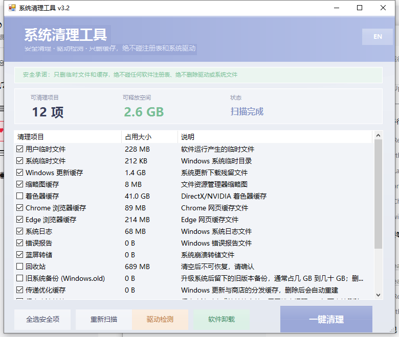
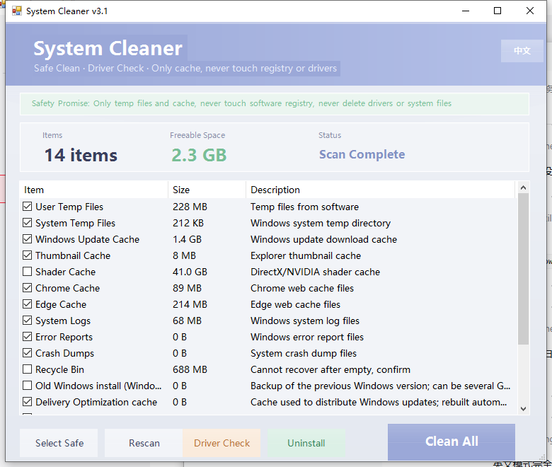

# CleanTool（免费）· CleanTool (Free)

一个**安全的** Windows 系统清理工具：玻璃拟态界面 · **中英双语** · 驱动检测 · 软件卸载。

> A **safe** Windows system cleaner with a glassmorphism UI, bilingual (中文 / English) interface, driver checker and software uninstaller.





---

## 🛡️ 安全承诺 · Safety Promise

> **只删除临时文件和缓存，绝不碰任何软件注册表、绝不删除驱动或系统文件。**

- 只清理**可安全重建的缓存与临时文件**
- **不碰注册表**（驱动重建/卸载残留属于独立功能，需你手动确认）
- **不删驱动、不删系统文件、不删个人文件**
- 涉及风险的项目（回收站 / Windows.old / WinSxS 清理）**默认不勾选**，且清理前必须二次确认

> Only temp files and caches are removed. The tool never touches software registries, drivers or system files. Risky items (Recycle Bin / Windows.old / WinSxS) are **unchecked by default** and always require confirmation.

---

## ✨ 功能 · Features

| 中文 | English |
|---|---|
| 🧊 玻璃拟态界面（柔和浅灰蓝 + 半透明卡片 + 薰衣草紫） | Glassmorphism UI (soft blue-gray, translucent cards, lavender) |
| 🌏 一键切换 **中文 / English**，列表与界面实时重译 | One-click **中文 / English** toggle; UI and list re-translate live |
| 🧹 18 个清理项，覆盖临时文件、浏览器缓存、更新缓存、着色器缓存等 | 18 cleanup targets: temp files, browser caches, update cache, shader cache… |
| ⚡ 扫描带进度条且界面不卡死，大目录也流畅 | Scanning shows progress and never freezes the UI |
| ⚠️ 清理前统一确认：项数、预计释放量、敏感项、浏览器占用提醒 | Pre-clean confirmation: item count, expected freed space, sensitive items, running-browser warning |
| 📝 结果标注被占用未删净的项目，并写入日志 | Reports items that were locked, and writes a log file |
| 📊 累计释放统计 | Cumulative freed-space stats |
| 🔧 驱动检测：注册表缺失/文件缺失的异常驱动可重建或清除残留 | Driver check: rebuild missing registry entries or clear residual ones |
| 🛡️ 系统文件检查 (sfc /scannow) 一键后台运行 | One-click background System File Checker |
| 🎮 反作弊残留清除（ACE / Vanguard / EAC / BattlEye / FACEIT） | Anti-cheat residue cleanup |
| 🗑️ 软件卸载器：调用官方卸载程序 + 清理残留目录与注册表项 | Software uninstaller: runs official uninstaller + cleans leftovers |
| 🌙 深色友好、圆角按钮、悬停动画 | Rounded buttons with hover animation |

### 🧹 18 个清理项 · Cleanup Targets

| 项目 · Item | 默认 · Default | 说明 · Notes |
|---|---|---|
| 用户临时文件 · User temp | ✅ | `%TEMP%` |
| 系统临时文件 · System temp | ✅ | `C:\Windows\Temp` |
| Windows 更新缓存 · Update cache | ✅ | 自动停/启 wuauserv |
| 缩略图缓存 · Thumbnail cache | ✅ | `thumbcache_*` |
| 着色器缓存 · Shader cache | ⬜ | DirectX / NVIDIA，可能很大；清理后游戏首次启动稍慢 |
| Chrome 缓存 · Chrome cache | ✅ | |
| Edge 缓存 · Edge cache | ✅ | |
| 系统日志 · System logs | ✅ | `C:\Windows\Logs` |
| 错误报告 · Error reports | ✅ | WER |
| 系统转储 · System dumps | ✅ | |
| 崩溃转储 · Crash dumps | ✅ | `%LOCALAPPDATA%\CrashDumps` |
| 传递优化缓存 · Delivery Optimization | ✅ | |
| 系统网络缓存 · INetCache | ✅ | |
| 回收站 · Recycle Bin | ⬜ | 需二次确认 |
| 旧系统备份 · Windows.old | ⬜ | 常占几 GB~几十 GB；会自动接管所有权；**删除后无法回退旧系统** |
| 其他浏览器缓存 · Other browsers | ⬜ | Brave / Vivaldi / Chromium / Opera |
| WinSxS 组件清理 (DISM) | ⬜ | 可释放数 GB，耗时数分钟，**清理后无法卸载已装更新** |
| 最近使用记录 · Recent items | ⬜ | 使用痕迹，按需勾选 |

---

## 🚀 使用方法 · Getting Started

### 方式一：直接用（推荐）
1. 下载 `dist/CleanTool.exe`
2. **右键 → 以管理员身份运行**（清理系统缓存和 DISM 必须提权）
   - 程序也会自动请求提权，弹 UAC 点是即可
3. 点「重新扫描」→ 勾选项目 → 点「一键清理」

> **首次运行可能出现 Windows SmartScreen 提示**（"Windows 已保护你的电脑"）：
> 点「更多信息」→「仍要运行」。这是因为 exe 没有代码签名证书，不是病毒。
> 杀毒软件偶尔也会误报（清理类工具调用 `takeown`/`icacls`/`dism`/`wevtutil` 属正常行为）。

### 方式二：从源码运行
```powershell
# 需要 Windows PowerShell 5.1（系统自带）
powershell -ExecutionPolicy Bypass -STA -File src\CleanTool.ps1
```
也可以直接双击 `run-from-source.bat`。

### 方式三：自己编译 exe
```powershell
Install-Module ps2exe -Scope CurrentUser   # 一次性
powershell -ExecutionPolicy Bypass -File tools\build.ps1
```

---

## 💻 系统要求 · Requirements

- Windows 10 / 11（64 位）
- Windows PowerShell 5.1（系统自带）
- **管理员权限**（清理系统缓存、DISM、sfc 需要）
- 无需安装、无需 .NET 下载、无第三方依赖

> 程序是**便携式**的：日志写在程序目录 `logs\`，统计写在 `cleanstats.json`，不写系统目录。

---

## 📁 目录结构 · Project Layout

```
cleantool-free/
├── src/CleanTool.ps1        # 全部源码（单文件 PowerShell + WinForms，约 1590 行）
├── dist/CleanTool.exe       # 已编译程序
├── docs/                    # 界面截图（中/英）
├── assets/                  # 图标
├── tools/build.ps1          # 一键编译脚本
├── run-from-source.bat      # 源码启动器
├── CHANGELOG.md
├── LICENSE
└── README.md
```

---

## 🇬🇧 English

A safe, portable Windows cleaner with a glassmorphism UI.

**Highlights**
- **Bilingual** — toggle 中文 / English; the whole UI *and* the item list re-translate instantly.
- **Safe by design** — only temp files and caches. Risky items are unchecked by default and confirmed before cleaning.
- **Responsive scanning** — progress bar plus per-item status; the window stays responsive and appears in ~3 seconds.
- **Honest results** — items that could not be fully deleted (files in use) are labelled, and a log is written to `logs\`.
- **18 targets** including Windows Update cache, shader caches, crash dumps, Delivery Optimization, INetCache, Windows.old and other Chromium browsers.
- **Extras** — driver checker (rebuild/clear), `sfc /scannow` runner, anti-cheat residue cleanup, software uninstaller with leftover cleanup.

**Run it**: download `dist/CleanTool.exe`, right-click → *Run as administrator*.
**Build it**: `powershell -ExecutionPolicy Bypass -File tools\build.ps1` (requires the `ps2exe` module).

---

## ⚠️ 免责声明 · Disclaimer

- 本工具会**永久删除文件**（清理项均已标明用途）。请在使用前确认勾选项，重要数据请先备份。
- 「回收站」「Windows.old」「WinSxS 组件清理」属于不可逆操作，删除后无法恢复/回退。
- 「反作弊残留清除」**不要**用于你仍在玩的游戏，否则需要重装。
- 本软件按「原样」提供，作者不对因使用本软件造成的任何数据丢失或损失负责。
- 请遵守你所在地区的法律法规。

> This tool **permanently deletes files**. Review your selections and back up important data first. Recycle Bin / Windows.old / WinSxS cleanup are irreversible. Do **not** clear anti-cheat residue for games you still play. Provided "as is", without warranty of any kind.

---

## 📄 License

代码以 [MIT License](LICENSE) 开源。
Released under the [MIT License](LICENSE).
